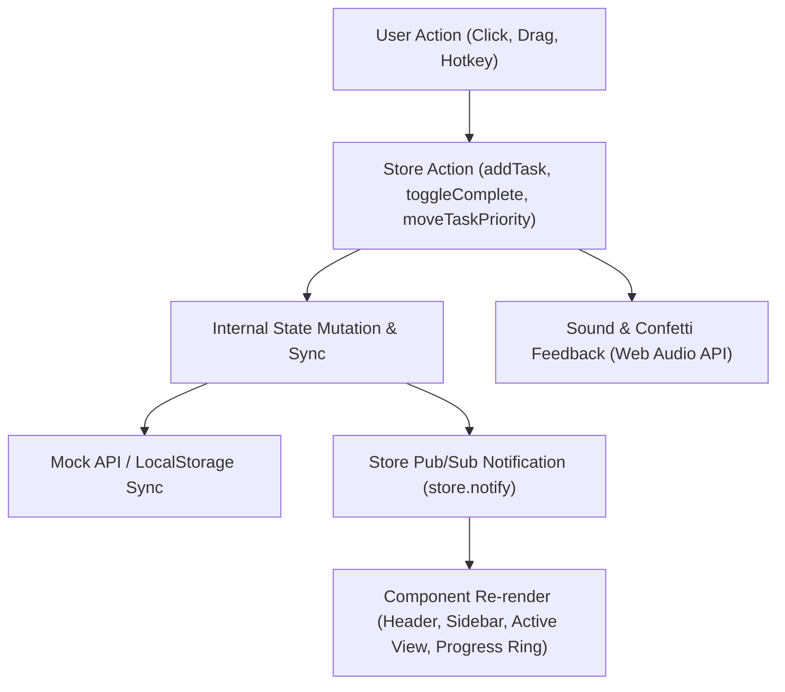

# ⚡ FocusFlow — Student Productivity & Assignment Dashboard

> **FocusFlow** is a modern student productivity dashboard engineered to transform a chaotic list of course assignments into an actionable daily focus view. Built with clean architecture, vanilla ES6+ modules, and an observable state store.

---

## 🚀 Quick Start

You can run FocusFlow immediately with **zero external installation or build step**:

### Option 1: Python Dev Server (Recommended)
```bash
cd focusflow-dashboard
python serve.py
```
*Automatically finds an open port (default `http://localhost:3000`) and serves the application with instant hot loading.*

### Option 2: Direct File Open
Simply double-click [`index.html`](file:///C:/Users/hayyy/.gemini/antigravity/scratch/focusflow-dashboard/index.html) or open it directly in any modern browser (Chrome, Edge, Firefox, Safari).

---

## 📋 Requirements & Features Checklist

### ✅ Base Requirements
- [x] **Create Tasks:** Form modal with title, subject/course, deadline (date & time), priority (`High`, `Medium`, `Low`), and completion state.
- [x] **Daily Actionable Dashboard:**
  - **Today's Tasks:** Filtered view of assignments due today, study workload calculator, and sub-status filters.
  - **Overdue Tasks:** Dedicated alert view highlighting past-due assignments with elapsed time and 1-click single/bulk rescheduling to today.
  - **Upcoming Deadlines:** Chronological view grouped into *Tomorrow*, *This Week (Next 2-7 Days)*, and *Later Deadlines*.
- [x] **Filter by Subject and Priority:** Multi-dimensional filtering by course/subject badge, priority level, and live search keyword queries.
- [x] **Data Persistence:** LocalStorage persistence with an asynchronous mock API layer (`mockApi.js`), realistic relative seed data, JSON export, and demo reset.

### 🌟 Brownie Points (All Completed!)
- [x] **Drag-and-Drop Priority Board:** Kanban board featuring 4 columns (*High Priority*, *Medium Priority*, *Low Priority*, and *Completed*). Supports HTML5 drag-and-drop, visual drop indicators, and SortableJS touch support.
- [x] **Progress Ring for Daily Completion:** Animated circular SVG progress ring dynamically computing daily completion percentage, remaining study minutes, study streaks, and confetti celebrations upon hitting 100%.
- [x] **Keyboard Shortcuts:** Global hotkey navigation (`N` for new task, `/` for search, `D` for theme toggle, `P` for focus timer, `1`-`5` for views, `?` for cheat sheet, `Esc` to close).
- [x] **Dark / Light Theme:** Modern CSS custom variable styling with persisted user preference (`localStorage`), system preference auto-detection, and smooth theme transitions.
- [x] **Responsive Mobile Layout:** Mobile-first layout featuring bottom navigation bar with badge counters, a floating action button (`+`), and slide-out navigation drawer.

---

## 🧠 State Management Explanation

FocusFlow utilizes an **Observable Central Store Pattern** with **Unidirectional Data Flow**, implemented in [`js/store.js`](file:///C:/Users/hayyy/.gemini/antigravity/scratch/focusflow-dashboard/js/store.js).



### 1. Single Source of Truth
The store maintains state inside a centralized container:
```javascript
this.state = {
  tasks: [],            // List of assignment objects
  loading: true,        // Async loading state
  filterSubject: 'all', // Active course filter
  filterPriority: 'all',// Active priority filter
  searchQuery: '',      // Search filter text
  currentView: 'today', // 'today' | 'board' | 'upcoming' | 'overdue' | 'all'
  theme: 'dark',        // 'dark' | 'light'
  undoAction: null,     // Deferred action for toast undo
  sortBy: 'deadline-asc'// Sorting criterion
};
```

### 2. Unidirectional Data Flow
Modifications to application state are made through explicit store methods:
- `addTask(taskData)`: Validates and appends a new assignment.
- `updateTask(taskId, updates)`: Updates assignment attributes and timestamps.
- `toggleComplete(taskId)`: Flips completion status and fires completion audio.
- `moveTaskPriority(taskId, columnId)`: Reprioritizes or completes tasks moved via drag-and-drop.
- `rescheduleTask(taskId, newDeadlineISO)`: Quick-updates task deadlines.
- `deleteTask(taskId)`: Removes a task while pushing an undo action onto the undo stack.

### 3. Reactive Pub/Sub Subscription
UI components subscribe to state emissions via `store.subscribe(listener)`. Any mutation immediately dispatches a notification that triggers efficient component re-renders:
```javascript
store.subscribe((state, event, data) => {
  this.handleStateChange(state, event, data);
});
```

### 4. Computed Getters (Selectors)
The store exposes zero-cost pure selectors to compute derived data without polluting core state:
- `getTodayTasks()`: Filters tasks matching today's calendar date.
- `getOverdueTasks()`: Identifies uncompleted tasks whose deadline is earlier than current time.
- `getUpcomingTasks()`: Isolates upcoming tasks beyond today.
- `getTodayStats()`: Computes completion percentage, total and remaining study workload minutes, and goal completion status.
- `getFilteredTasks()`: Applies multi-criteria filtering (search string, subject, priority, and sort order).

### 5. Undo & Disaster Recovery
When a user deletes an assignment, an undo token is created with a 6-second timeout. An interactive toast notification appears with an "Undo" action button, allowing instant restoration of the deleted task without data loss.

---

## ⌨️ Keyboard Shortcuts

| Shortcut | Description |
| :--- | :--- |
| <kbd>N</kbd> or <kbd>+</kbd> | Open New Assignment Modal |
| <kbd>/</kbd> | Focus Global Search Input |
| <kbd>D</kbd> | Toggle Dark / Light Theme |
| <kbd>P</kbd> | Open Pomodoro Focus Timer |
| <kbd>1</kbd> | Switch to **Today's Focus** View |
| <kbd>2</kbd> | Switch to **Priority Board** (Kanban) |
| <kbd>3</kbd> | Switch to **Upcoming Deadlines** |
| <kbd>4</kbd> | Switch to **Overdue Tasks** |
| <kbd>5</kbd> | Switch to **All Assignments** |
| <kbd>?</kbd> | Display Keyboard Shortcuts Cheat Sheet |
| <kbd>Esc</kbd> | Close Any Active Dialog or Clear Search |

---

## 📁 Project Structure

```
focusflow-dashboard/
├── index.html                   # HTML5 application shell & CDN imports
├── serve.py                     # Python HTTP development server
├── README.md                    # Documentation & architecture guide
├── .gitignore                   # Git ignore specifications
├── css/
│   └── styles.css               # Typography, scrollbars, drag styles & animations
├── assets/
│   └── favicon.svg              # FocusFlow lightning bolt logo
└── js/
    ├── app.js                   # Application coordinator & event delegation
    ├── store.js                 # Central reactive state store & pub/sub
    ├── mockApi.js               # Mock async API & seed dataset
    ├── components/
    │   ├── header.js            # Top header with search, filters & actions
    │   ├── sidebar.js           # Desktop navigation, subject filters & metrics
    │   ├── progressRing.js      # SVG circular progress ring & milestones
    │   ├── taskCard.js          # Reusable assignment card component
    │   ├── todayView.js         # Daily actionable view & subtabs
    │   ├── priorityBoard.js     # Drag-and-drop Kanban priority board
    │   ├── overdueView.js       # Overdue alerts & 1-click reschedule
    │   ├── upcomingView.js      # Chronologically grouped future deadlines
    │   ├── allTasksView.js      # Master searchable & sortable assignment list
    │   ├── taskModal.js         # Create & edit assignment modal dialog
    │   ├── shortcutsModal.js    # Interactive keyboard shortcuts guide
    │   ├── pomodoroModal.js     # Built-in 25/5/15 min study focus timer
    │   └── toast.js             # Notification snackbar with undo trigger
    └── utils/
        ├── dateUtils.js         # Relative date formatting & comparison helpers
        ├── audio.js             # Web Audio API synthesized completion chimes
        └── confetti.js          # Canvas Confetti milestone bursts
```

---

## 🎨 Design System & Accessibility

- **Color Harmony:** Tailwind CSS palette with course-coded tag badges (Indigo for CS, Emerald for Math, Amber for Physics, Rose for Literature, Cyan for Chemistry, Purple for History).
- **Audio Feedback:** Synthesizes sound using the standard HTML5 `AudioContext` with zero external audio assets. Includes an instant mute/unmute toggle.
- **Micro-Interactions:** Smooth stroke dashoffset animations, hover lifts, drag ghosting, and celebration confetti.
- **Mobile First:** Touch-friendly tap targets (minimum 44x44px), sticky bottom navigation bar, and slide-over drawer navigation.
